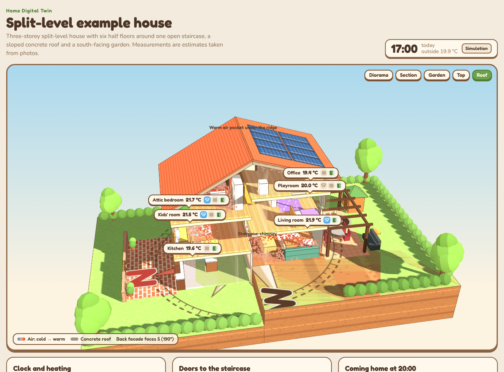

# Home Digital Twin

A cosy 3D model of your house that shows how warm air moves between rooms, connected to Home Assistant, with a solar panel calculator and automations that heat the house with the solar energy you would otherwise give away.



Everything runs in the browser from plain files. There is nothing to compile, no server to run and no account to create.

## What you get

| Part | What it does |
| --- | --- |
| **3D twin** (`viewer/index.html`) | Your house as a diorama: rooms, stairs, doors, radiators, heat pumps, solar panels, the sun moving across the sky and the compass painted on the ground. A zone model simulates the temperature of every room until the next morning; the air moves as thousands of coloured dots, blue when cold and red when warm. Connect it to Home Assistant to see real temperatures, heat pumps and solar production live. |
| **Solar calculator** (`viewer/solar.html`) | Fits panels on each roof face, simulates every hour of a typical year with or without a battery and recommends the number of panels, inverter and battery, with self-consumption, savings and payback. Can use PVGIS data for your exact location. |
| **Home Assistant package and blueprints** (`homeassistant/`) | Switches heat pumps on, one at a time and in your order of priority, only with solar energy that will come back to the battery before sunset. Includes a bed-level setpoint for tall rooms and an A/B test to measure whether it is worth it. |
| **Tools** (`tools/`) | Check your `house.json`, download PVGIS yields for your roof. |
| **Guides** (`docs/`) | Everything needed to build it yourself, from photos of the house to a measured result. |

## Try it in two minutes

```bash
git clone https://github.com/dvalledor/home-digital-twin.git
cd home-digital-twin/viewer
python3 -m http.server 8000
```

Open <http://localhost:8000> for the twin of the example house and <http://localhost:8000/solar.html> for the calculator. (Browsers do not load the house file from a double-clicked `file://` page, hence the small web server.)

## Build your own

Follow **[docs/build-guide.md](docs/build-guide.md)**. In short:

1. **Measure and photograph** the house and turn the photos into a `house.json` ([photos to model](docs/photos-to-model.md), [file reference](docs/house-config.md)).
2. **Find the orientation**, the easy way is from your solar panels ([orientation](docs/orientation.md)).
3. **Size your solar installation**, or describe the one you have ([solar guide](docs/solar.md)).
4. **Connect Home Assistant** and host the twin inside it ([Home Assistant](docs/home-assistant.md)).
5. **Install the automations** for solar surplus heating ([automations](docs/automations.md)).
6. **Calibrate** the model with your own history ([thermal model](docs/thermal-model.md)) and **measure** the result with an A/B test ([A/B test](docs/ab-test.md)).

## Repository layout

```
viewer/                 the web app: copy this folder anywhere (or into Home Assistant)
  index.html            3D twin
  solar.html            solar sizing calculator
  solar.js              shared solar model
  house.example.json    example house (rename a copy to house.json for yours)
homeassistant/
  packages/             helpers and template sensors
  blueprints/           surplus heating, marker cleanup, bed-level setpoint
schema/                 JSON schema of house.json
tools/                  validate_house.py, pvgis_sizing.py
docs/                   guides
```

## The example house

`viewer/house.example.json` is a real split-level house with six half floors around one open staircase, a sloped concrete roof, four heat pumps, gas radiators, 4.3 kWp of solar panels and a 5 kWh battery. Names, address and anything personal have been removed and the location is moved to the centre of Madrid.

## Accuracy

The twin is a teaching and decision tool, not an engineering study. The thermal model is a handful of connected rooms with parameters you estimate and then calibrate; trust its trends before its decimals. The solar model is tuned to land within about ±10 % of PVGIS for typical roofs; use PVGIS numbers and an installer's quote before you buy anything. Electrical and roof work must be done by qualified professionals; see the safety notes in the [build guide](docs/build-guide.md#safety-and-rules).

## Licence

MIT, see [LICENSE](LICENSE). Three.js (MIT) is loaded from cdnjs.
