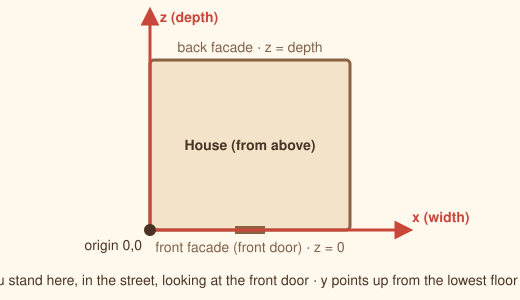

# From photos to a model

The twin needs a few dozen numbers about your house. You get them from a walk around with a tape measure and a phone. This page lists what to capture and gives a prompt that turns your photos and notes into a first `house.json`.

## The coordinate system

Stand in the street looking at the front door.

- **x** runs from left (0) to right (`footprint.width`).
- **z** runs from the front facade (0) to the back facade (`footprint.depth`).
- **y** is height, 0 at the lowest floor of the house.



All measurements are in metres. Interior measurements are fine; the model does not draw wall thickness.

## What to photograph

Take each photo straight on where you can, and keep a note of which is which.

1. **Each facade**, from far enough to see the whole wall and the roof edge: front, back and both sides.
2. **The roof** from the garden or from a window, showing the solar panels if you have them.
3. **Each room** from the doorway and from the opposite corner: where the windows, radiators, heat pumps, beds and big furniture are.
4. **The staircase** from the bottom and from the top landing.
5. **Every heater**: radiators (count the fins), heat pump indoor units, their labels (model and power).
6. **A floor plan**, if you have one from the sale or the architect. It saves most of the measuring.

## What to measure

| Measure | Why |
| --- | --- |
| Outside width and depth of the house | `footprint` |
| Floor height of each level relative to the lowest one | `rooms[].y` (in split-level houses each half floor is a level) |
| Ceiling height of each room | `rooms[].height` |
| Height of the eaves front and back, and of the ridge; where the ridge is from the front | `roof` |
| Each room's rectangle (from which wall to which wall) | `rooms[].x0 x1 z0 z1` |
| Where each door is | `rooms[].door` |
| Windows: position, width, height, sill height | `windows` |
| Heaters: position, height above the floor, power | `devices` |

A laser meter makes this a one-hour job. Round to 5 cm; nothing in the physics needs better.

For the roof, if you cannot climb (do not), measure the eave heights from outside and count brick or block courses, or use the panel tilt from your solar installation documents: the panels usually lie flat on the roof, so their tilt is the roof pitch.

## Generate the file with an AI assistant

Give your assistant the photos, your measurements and `schema/house.schema.json`, `docs/house-config.md` and `viewer/house.example.json` from this repository, then this prompt:

```text
You are helping me build a digital twin of my house for the Home Digital Twin viewer.
Attached: photos of my house, my measurements, the JSON schema, the field reference and an example file.

Write a complete house.json for my house that validates against the schema.

Rules:
- Coordinates in metres. Looking at the front door from the street: x from left (0) to right,
  z from the front facade (0) to the back facade, y up from the lowest floor.
- One entry in "rooms" per room or half floor that has its own temperature. Each room is a
  rectangle x0..x1, z0..z1 at floor level y. Rooms directly under the roof get "underRoof": true.
- Put a door wherever a room opens to the staircase or hall that connects the floors.
- "devices": one entry per radiator and per heat pump indoor unit, at the position where it
  hangs ("pos" is x, y, z of its base or centre), "facing" the direction it blows or radiates.
- Thermal values: start from the example and scale capacityKwhPerK with the room's floor area
  (about 0.06 kWh/K per m2 of floor for brick or concrete houses) and uaKwPerK with its exterior
  wall, window and roof area. Rooms under a concrete roof get a roofMass block.
- Use only measurements I gave you or that you can read from the photos. When you have to guess,
  list each guess after the JSON so I can check it.
- Keep furniture to the big items (beds, sofas, tables, wardrobes) as simple boxes.
- Do not include names, addresses or anything personal.

My measurements:
<paste them here>

My location (city is enough), the compass direction the back facade looks at,
and my solar panels (number, watts, tilt, azimuth, inverter, battery) if any:
<paste them here>
```

Then:

1. Save the answer as `viewer/house.json`.
2. Run `python3 tools/validate_house.py viewer/house.json`.
3. Open the twin, use the **Top** and **Section** views and compare with your photos. Fix what is off, room by room.

## Tips for tricky houses

- **Split levels**: every half floor is its own room with its own `y`. The staircase alternates between a front and a back lane; `stairs.frontLaneX` and `backLaneX` are their x positions.
- **Open plan**: one big room is fine. If the living room opens to the kitchen with no door, make them one room or give them a door that you keep open.
- **L-shaped houses**: the viewer draws a rectangular footprint. Use the bounding rectangle and leave the missing corner as garden; only the rooms carry physics.
- **Bungalows**: one level, `y = 0` everywhere, `underRoof` for rooms with sloped ceilings.
- **Flat roofs**: set `eaveFrontY`, `eaveBackY` and `ridgeY` almost equal (a few centimetres apart) and `ridgeZ` in the middle.
