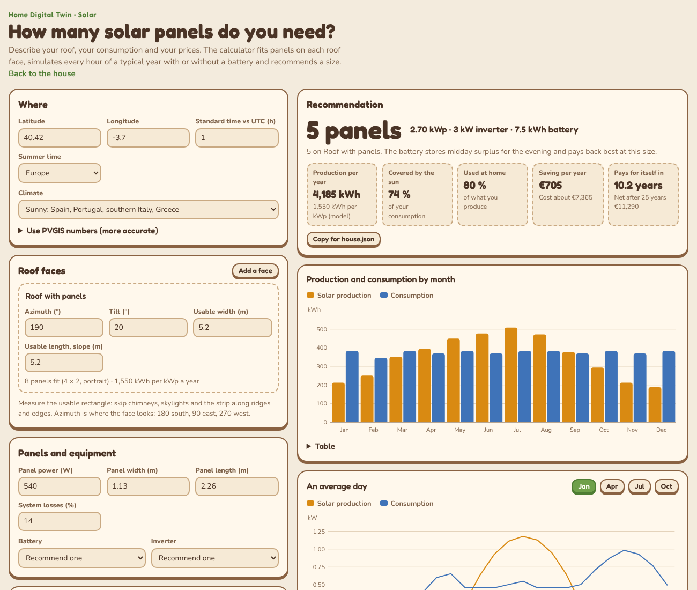

# Solar panels

This page explains how to size a solar installation with the calculator (`viewer/solar.html`), how to get accurate numbers from PVGIS, how to choose the inverter and the battery, and how to connect the result to Home Assistant and the twin.



## 1. Collect your data

| What | Where to find it |
| --- | --- |
| Electricity per year (kWh) | Add up 12 months of bills, or the annual summary in your supplier's website. |
| When you use it | Rough share between 09:00 and 18:00. 25 to 35 % for a family out at work and school, 40 to 60 % if someone works from home or a heat pump runs in the day. |
| Season pattern | More in winter with a heat pump, more in summer with air conditioning. |
| Roof faces | For each slope you could use: the direction it looks (azimuth), its pitch (tilt) and the usable rectangle (see below). |
| Prices | What you pay per kWh, what you would be paid for exported kWh, the installed cost per Wp in your area (ask an installer or look at recent quotes), and the battery price per kWh. |

**Usable rectangle**: measure the slope along the roof (not the horizontal), and leave out chimneys, skylights, vents, the strip near the ridge and edges (often 30 to 50 cm by local fire or wind rules) and any part shaded for long by trees or neighbours. The calculator adds a 30 cm margin on each side and tries portrait and landscape.

## 2. Use the calculator

1. Serve the `viewer` folder (`python3 -m http.server 8000`) and open <http://localhost:8000/solar.html>. If a `house.json` with a `solarPanels` block is next to it, the calculator starts from it.
2. Fill **Where**, **Roof faces**, **Panels and equipment**, **Your consumption** and **Prices**. Everything recalculates as you type and is remembered in this browser.
3. Read the **Recommendation**: number of panels, peak power (kWp), inverter and battery, with production, the share of your consumption covered by the sun (self-sufficiency), the share of the production you use at home (self-consumption), saving per year, cost and payback.
4. Move **Size the panels to cover**: 100 % sizes the panels to make, over a year, as much as you use. Where exported energy is paid little, 70 to 100 % usually pays back fastest; with good export prices or plans for an electric car or heat pump, more.
5. Look at **Other sizes** to see what you gain or lose with a few panels more or less, each with its best battery.
6. **Copy for house.json** gives you the `solarPanels` block for the twin.

### How the calculator works

- **Panels that fit**: for each face it tries rows and columns in portrait and in landscape and keeps the layout with more panels. The best-producing faces are filled first.
- **Production**: for the middle day of each month it computes the sun position every 10 minutes, a clear-sky irradiance (Haurwitz for global, Meinel for direct), the irradiance on the tilted panels (direct beam with an incidence-angle loss, isotropic diffuse sky, ground reflection) and multiplies by the climate preset's monthly clearness. Then system losses (default 14 %), a cell-temperature loss of 0.35 % per °C above 25 °C, and the inverter limit. The presets were tuned to stay within about ±10 % of PVGIS for south-facing roofs in Spain, France, Germany and the UK.
- **Self-consumption**: every hour of an average day per month, the house consumes a typical profile (morning and evening peaks plus your daytime share), the panels supply it first, the surplus charges the battery (90 % usable, 92 % round trip), the battery discharges when the panels are not enough, and the rest is imported or exported. Each month mixes sunny, average and cloudy days so that the battery is not overestimated.
- **Battery**: for each size it tries no battery, 2.5, 5, 7.5, 10, 12.5, 15 and 20 kWh and keeps the one with the best 25-year result.
- **Inverter**: the smallest standard size at or above kWp / 1.25. A DC/AC ratio of 1.1 to 1.3 is normal and loses very little at the midday peak.
- **Money**: saving = energy used at home × buying price + exported energy × selling price, with 0.5 % panel degradation per year and the price rise you enter. Payback is when the accumulated saving equals the cost. No subsidies, taxes, financing or maintenance are included: add them yourself.

## 3. Get accurate numbers from PVGIS

[PVGIS](https://re.jrc.ec.europa.eu/pvg_tools/en/) is the European Commission's free solar calculator. It uses satellite data for your exact location and includes the horizon (mountains, not trees or buildings).

**In the browser**: choose *Grid connected*, enter installed peak power 1 kWp, system loss 14 %, your slope (tilt) and azimuth (**PVGIS: 0 = south, −90 = east, 90 = west**). In *Monthly energy output* copy the 12 values of E_m and paste them in the calculator under **Use PVGIS numbers**, one line per roof face, in the same order as the faces.

**From the terminal**:

```bash
cd home-digital-twin
python3 tools/pvgis_sizing.py --lat 40.42 --lon -3.70 --face south:180:30 --face west:270:30
# or take location and panels from your house file and save the result into it:
python3 tools/pvgis_sizing.py --house viewer/house.json --write
```

The script prints the kWh per kWp for each month, a line ready to paste in the calculator and, with `--write`, stores the values in `solarPanels.pvgisMonthlyKwhPerKwp` so the twin uses them too.

## 4. Choosing equipment

- **Panels**: 400 to 550 W monocrystalline panels are standard. Compare by price per Wp and warranty (product 12 to 25 years, performance 80 to 87 % after 25 to 30 years). Larger panels are cheaper per Wp but may fit worse on small or broken roofs; try both sizes in the calculator.
- **East and west faces** produce 10 to 20 % less per panel than south but spread production over the day, which raises self-consumption. They are often worth using.
- **Shade** is the enemy: a shadow on one panel of a string can pull down the whole string. With partial shade use panel optimisers or micro-inverters.
- **Inverter**: a **hybrid inverter** if you want a battery now or later. Prefer one with a local interface (Modbus TCP or a local API) so Home Assistant can read it without the cloud.
- **Battery**: size it to your evening and night consumption, not more; the calculator shows when it stops paying back. Check usable capacity, warranty cycles and whether it can supply the house during a blackout (backup), which usually needs extra hardware.
- **Quotes**: ask at least two installers. Compare kWp, panel and inverter models, battery usable kWh, their production estimate (compare it with PVGIS), warranties, who handles the paperwork and the price per Wp.

## 5. Connect it to Home Assistant and the twin

1. Add your inverter's integration (local if possible) so Home Assistant has: solar power, battery level (%), grid power (sign: export positive or negative) and energy totals.
2. Add **Forecast.Solar** with the same kWp, tilt and azimuth (180 = south). It creates `sensor.energy_production_today_remaining`, used by the surplus automations.
3. Fill the `solarPanels` block of `house.json` and the `homeAssistant` entities (`solarPowerEntity`, `batterySocEntity`, `gridPowerEntity`). The twin then shows the panels on the right roof slope, today's estimated production, the heat pumps' consumption and, in live mode, the real power and battery level.
4. After a couple of weeks compare the real daily production with Forecast.Solar's forecast to set the forecast correction factor ([automations.md](automations.md#tuning)).

## Safety and paperwork

Solar installations must be designed and installed by qualified professionals: DC circuits stay live in daylight, roofs are dangerous and the grid connection is regulated. Depending on where you live you may need a building notice or permit, a registration with the grid operator, a contract to be paid for exported energy and possibly a structural check of the roof. Ask your installer what applies and who files it. Look also for local subsidies and tax deductions for solar and batteries; they can shorten the payback a lot and are not included in the calculator.
